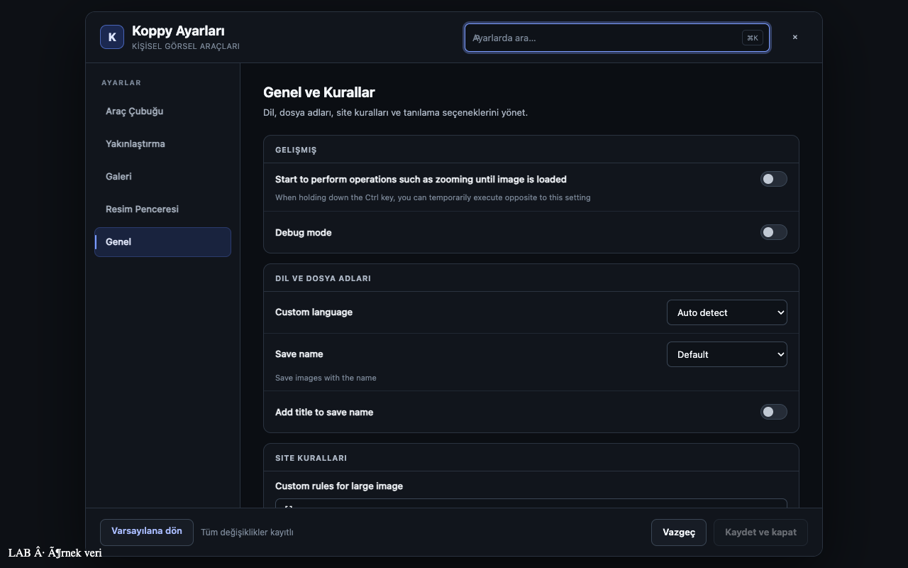
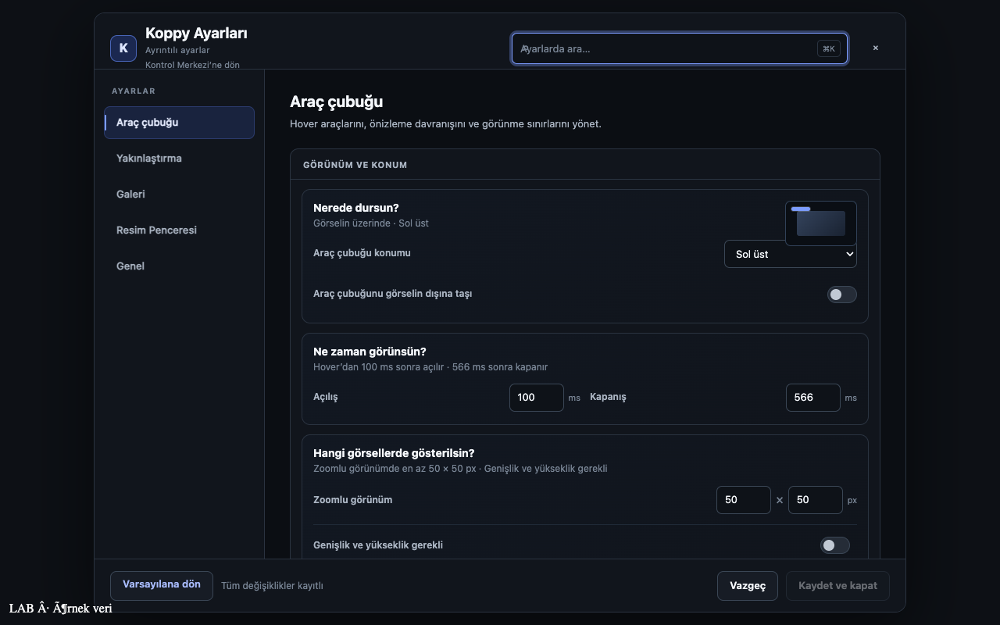

# K28 — Ayrıntılı ayarlar sürekliliği

**LAB · örnek veri** — İzole Playwright Chromium, tam `dist/Koppy.user.js`, stub GM API ve örnek sayfa. Kullanıcı uygulaması/Zen/Tampermonkey veya host GUI kullanılmadı.

## Değişiklik
- K26 `2601232ffe18fb7b09cabe1405e448f9d545bd40` taban alındı.
- Kontrol ve Davranış → Araç çubuğu; eşlenmeyen Araçlar → Genel. Mevcut güvenli iframe ve sekme mekanizması korundu.
- Modal kapandıktan sonra aynı Kontrol Merkezi sekmesi yeniden gösteriliyor. X, Escape, Vazgeç, Kaydet ve kapat ve yeni geri düğmesi doğrulandı.
- Modal başlığı altında “Ayrıntılı ayarlar” ve “Kontrol Merkezi’ne dön”; Araç çubuğu başlığı iki yüzeyde aynı yazımla sunuluyor. Yeniden tasarım veya vendor DOM müdahalesi yok.
- Geri düğmesi mevcut kaydedilmemiş-değişiklik onayını kullanıyor; kaydı atlayan yeni kapanış yolu eklenmedi.

## RED → GREEN
1. Tam-dist doğru sekme testi: `#pv-prefs_section_header_0` için beklenen `aria-selected=true`, alınan `false`; exit 1. Sekme aktarımı sonrası exit 0.
2. Aynı bölüme dönüş testi: kapanış sonrası `.panel.open .tab[aria-pressed="true"]` bulunamadı; exit 1. Geri dönüş bağlantısı sonrası exit 0. İlk denemede yanlış `.active` seçicisi düzeltildi ve gerçek seçiciyle RED yeniden koşuldu.
3. Başlık geri düğmesi testi: düğme bulunamadı; exit 1. Minimal başlık eki sonrası exit 0.

Fixture geliştirmesinde yanlış menü/sekme seçicileri ve salt-okunur iframe erişimi düzeltildi; bu kurulum hataları RED kanıtı sayılmadı. Kaydet regresyonu önce değişiklik yapmadığı için disabled düğmeye basıyordu; gerçek debug alanını değiştirip kaydeden fixture ile düzeltildi.

## Nihai kapılar
- `bun run build`: exit 0; `dist/Koppy.user.js` üretildi.
- `bun run test`: exit 0, **92/92**. Birim testler `node:test`; bun:test eklenmedi.
- `bunx --no-install playwright test`: exit 0, **60/60** (6 yeni süreklilik e2e).
- `git diff --check`: exit 0.
- Mevcut tekrar-aç helper'ı, kapanınca artık açık kalan paneli yanlışlıkla toggle ile kapatmayacak şekilde güncellendi.
- Loglar: [unit.log](unit.log), [e2e.log](e2e.log).

## LAB kareleri
Aynı tam-dist örnek sayfa, 1280×800. Damga DOM metni: `LAB · örnek veri`.

### Önce — Genel'e iniş

### Sonra — Araç çubuğu ve geri bağlantısı

## Teslim sınırı
Yalnız yerel aday; push/merge/tag/kurulum/yayın yok. Sürüm **0.8.2** değişmedi. Bağımsız inceleme için hazır.
